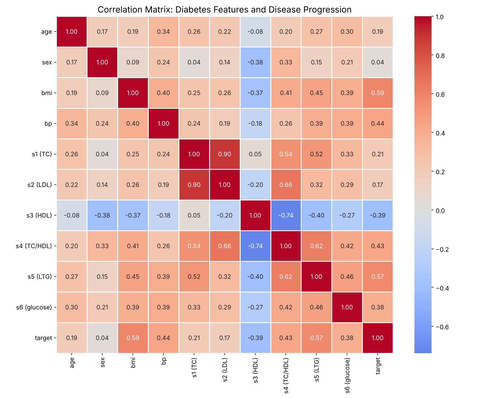
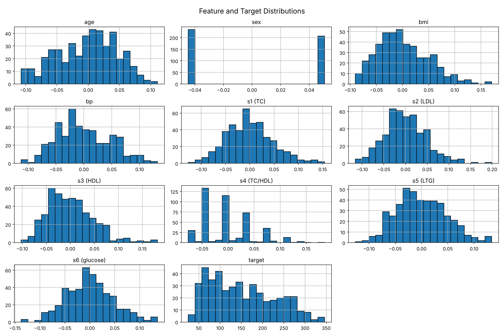
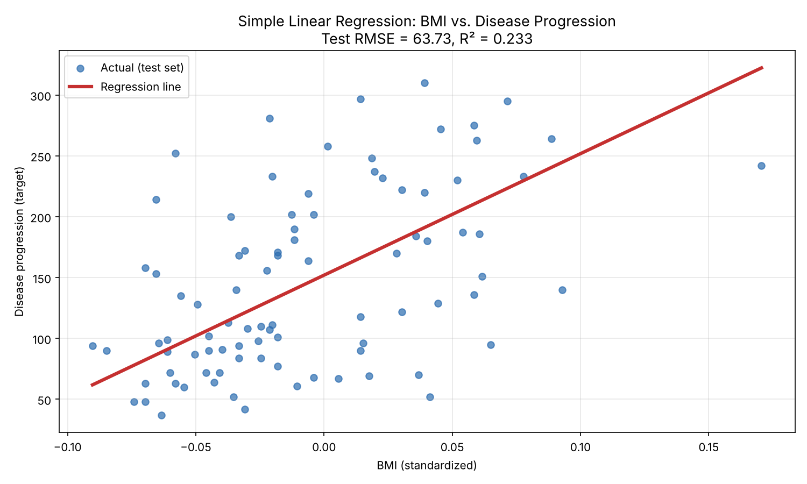
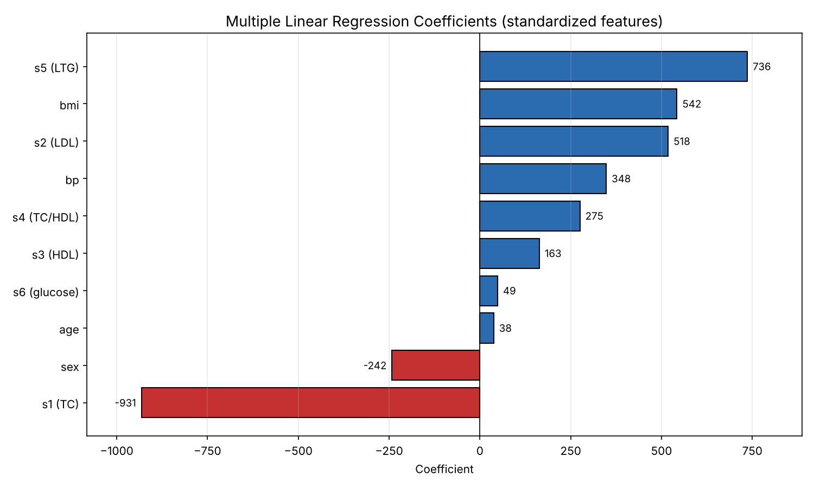
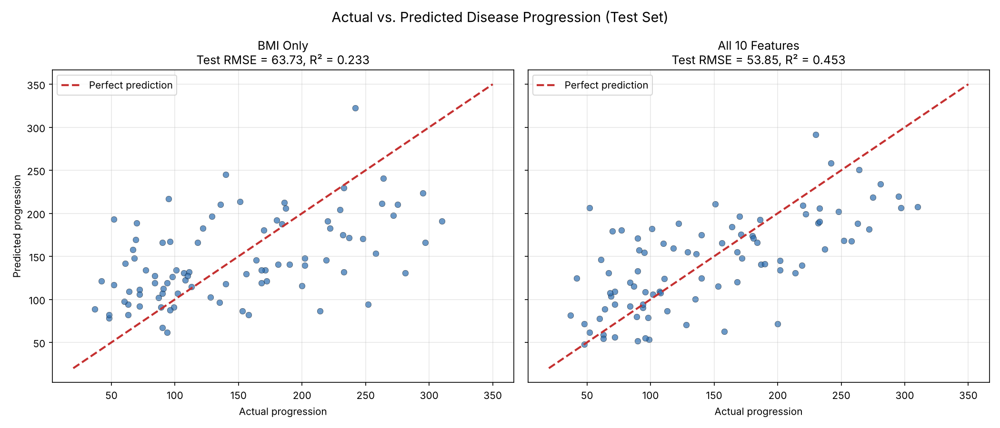

# Predicting Diabetes Progression with Regression Analysis 🩺

This repository contains a supervised machine learning project that predicts diabetes disease progression from baseline health indicators using multiple linear regression. The analysis compares a full 10-feature model to a single-feature BMI baseline to show how much predictive value each additional health measure contributes.

---

## Project Overview 📊

This project uses scikit-learn's `LinearRegression` to predict a quantitative measure of diabetes progression one year after baseline. Using the diabetes dataset from Efron et al. (2004), which includes 442 patients and 10 baseline health variables, the analysis moves from exploratory data analysis and correlation analysis through model training, evaluation, and comparison against a simpler baseline model.

**Dataset at a glance:**
- 442 patients, 10 numeric features
- Target: disease progression score one year after baseline (range 25-346, mean 152.1, standard deviation 77.1)
- No missing values; features are already mean-centered and scaled
- `sex` is a binary categorical variable encoded numerically

| Feature | Description |
|---------|-------------|
| age | Age in years |
| sex | Sex (binary) |
| bmi | Body mass index |
| bp | Average blood pressure |
| s1 | Total serum cholesterol (TC) |
| s2 | Low-density lipoproteins (LDL) |
| s3 | High-density lipoproteins (HDL) |
| s4 | Total cholesterol / HDL ratio |
| s5 | Log of serum triglycerides (LTG) |
| s6 | Blood sugar level (glucose) |

---

## Key Findings 🔎

### Distribution Patterns

Most features are roughly normally distributed, consistent with the pre-applied standardization. The `sex` feature shows a clear two-value split, and the target variable is **right-skewed**: most patients show lower progression scores, with a long tail of higher values.

### Top Predictors of Disease Progression

Correlation analysis identified a clear hierarchy of linear relationships with diabetes progression:

| Feature | Correlation with Target |
|---------|------------------------|
| BMI | 0.586 |
| Triglycerides (s5) | 0.566 |
| Blood pressure | 0.441 |
| Cholesterol / HDL ratio (s4) | 0.430 |
| Blood sugar (s6) | 0.382 |
| Total cholesterol (s1) | 0.212 |
| Age | 0.188 |
| LDL (s2) | 0.174 |
| Sex | 0.043 |
| HDL (s3) | -0.395 |

- **BMI** - strongest single predictor of disease progression
- **Triglycerides** - nearly as predictive as BMI
- **Blood pressure** - meaningful secondary predictor
- **HDL cholesterol** - the only negative relationship, suggesting higher "good" cholesterol is associated with slower progression
- **Sex** - almost no linear relationship, though a non-linear relationship can't be ruled out

### BMI as a Single Predictor

Plotting BMI against progression shows a clear upward trend, but with wide scatter around the regression line. BMI is important, but not sufficient on its own.

### Multicollinearity Among Cholesterol Measures

The cholesterol features are strongly correlated with one another, which makes their individual coefficients unstable. Total cholesterol (s1) receives a large negative coefficient (-932) while LDL (s2) receives a large positive one (518), largely offsetting each other. HDL (s3) has a negative correlation with progression on its own but a positive coefficient in the full model. These coefficients reflect shared variance among the lipid measures rather than independent effects, so they should not be interpreted in isolation.

---

## Models and Performance 📈

### Model Configuration

- **Algorithm**: `LinearRegression` (ordinary least squares)
- **Train/test split**: 80/20 (`random_state=42`), yielding 353 training and 89 test samples
- **Evaluation metrics**: RMSE (primary), MAE, and R²

### Model Comparison

| Model | Features | Train RMSE | Test RMSE | Test MAE | Test R² |
|-------|----------|------------|-----------|----------|---------|
| Multiple Linear Regression | All 10 | 53.56 | 53.85 | 42.79 | 0.453 |
| Simple Linear Regression | BMI only | 62.08 | 63.73 | 52.26 | 0.233 |

The full model reduces test RMSE by about 10 points and nearly **doubles the explained variance** (R² of 0.45 vs. 0.23) compared to the BMI-only model. Training and test RMSE for the full model are nearly identical (53.56 vs. 53.85), indicating **minimal overfitting** and good generalization.

### Actual vs. Predicted Analysis

Predictions track the overall trend, but the model explains less than half of the variance in disease progression. Errors are largest at the high end of the progression scale, where the right-skewed target has fewer training examples.

---

## Key Takeaways 💡

1. **Combined Health Indicators Outperform Any Single Measure**
   - BMI alone explains about 23% of the variance in progression
   - Adding blood pressure, lipid, and glucose measures raises that to about 45%

2. **Metabolic Markers Drive Progression**
   - BMI, triglycerides, and blood pressure are the strongest linear predictors
   - HDL cholesterol is the only feature with a protective (negative) association

3. **Correlated Features Require Careful Interpretation**
   - The cholesterol measures share substantial variance, producing large, offsetting coefficients
   - Coefficient size alone is not a reliable guide to feature importance when predictors are correlated

4. **Linear Models Have Limits Here**
   - Over half the variance remains unexplained, suggesting non-linear effects or missing predictors
   - The right-skewed target leads to larger errors for high-progression patients

---

## Repository Contents 📁

1. **Notebooks**
   - [Predicting Diabetes with Linear Regression](predicting-diabetes-linear-regression.ipynb) (IPYNB)

2. **Visualizations**
   - [Correlation Heatmap](correlation-heatmap.png) (PNG)
   - [Feature Histograms](feature-histograms.png) (PNG)
   - [BMI Regression Line](bmi-regression-line.png) (PNG)
   - [Model Coefficients](model-coefficients.png) (PNG)
   - [Actual vs Predicted](actual-vs-predicted.png) (PNG)

---

## Model Evolution 🧠

This project demonstrates a progression from exploration to a full multivariate model:

1. **Exploratory Data Analysis**: Histograms and correlation analysis revealed the dataset's structure and identified BMI, triglycerides, and blood pressure as the strongest candidate predictors.

2. **Simple Linear Regression (BMI only)**: Established a single-feature baseline, confirming BMI's predictive value but showing wide scatter around the regression line.

3. **Multiple Linear Regression (all features)**: Reduced prediction error and roughly doubled explained variance by combining metabolic, lipid, and demographic indicators.

Comparing the two models quantifies how much each additional health measure contributes beyond the single strongest predictor.

---

## Future Work 🚀

Potential extensions of this analysis include:

- Regularized regression (Ridge, Lasso) to address multicollinearity among the cholesterol measures (s1, s2, s4) and produce more stable coefficients
- k-fold cross-validation for a more reliable error estimate on a small dataset
- Log-transforming the right-skewed target to improve predictions for high-progression patients
- Non-linear models (random forest, gradient boosting) to capture interaction effects
- Follow-up study on LDL cholesterol and cardiovascular health, examining how the LDL-heart disease relationship varies with low-carbohydrate dietary patterns (using a dataset with diet and cardiac outcome data, such as NHANES)

---

## Contact Information ✉️

For inquiries about this analysis:

- [LinkedIn Profile](https://www.linkedin.com/in/melissaslawsky/)
- [Client Results](https://melissaslawsky.com/portfolio/)
- [Tableau Portfolio](https://public.tableau.com/app/profile/melissa.slawsky1925/vizzes)
- [Email](mailto:melissa@melissaslawsky.com)

---

## Disclaimer 📝

This project was completed as part of the [Udacity Data Science Nanodegree](https://www.udacity.com/course/data-scientist-nanodegree--nd025) program. The diabetes dataset (Efron, Hastie, Johnstone & Tibshirani, 2004) is publicly available through scikit-learn, and the exercise structure was provided by Udacity. All analysis, interpretation, and documentation are my own. This project is for educational purposes only and is not medical advice.

---

© Melissa Slawsky 2026. All Rights Reserved.
